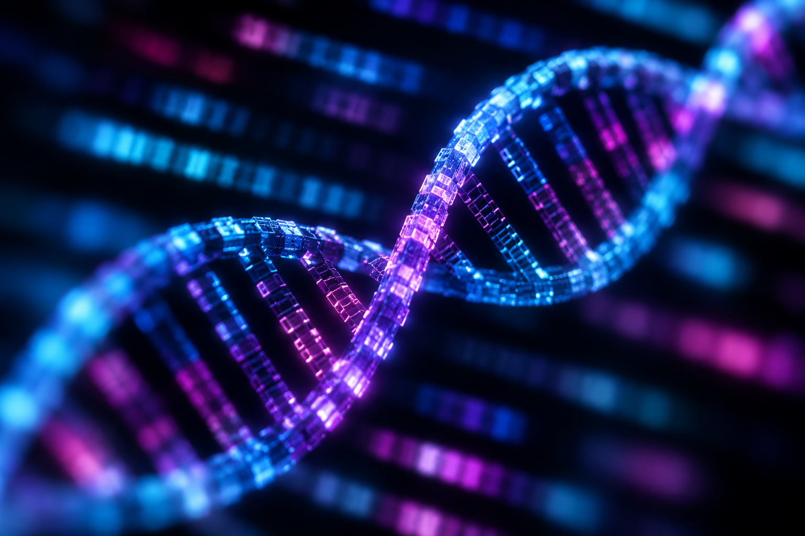

::: {.course-meta-block .quarto-title-meta}
:::: {.quarto-title-meta-heading}
Course dates
::::
:::: {.quarto-title-meta-contents}
 
::::
:::

This course provides a solid introduction to bioinformatics, focusing on essential methods and tools for analyzing DNA sequences and protein structures.

Students will learn how to:

- Work with biological databases and compare genetic and protein data.

- Use software such as EMBOSS, UGENE, and R for sequence and statistical analyses.

- Work in a High Performance Cluster Unix/Linux environment, as well as apply web-based bioinformatics tools.

- Understand key bioinformatics concepts including phylogeny, comparative and functional genomics, and Next Generation Sequencing (NGS).

SLUBI contributes several parts of the course: the introduction to the command line, working in HPC environments, coding for smart greenhouses, and Next Generation Sequencing, as well as RNA sequencing.

{.class width=60%}
