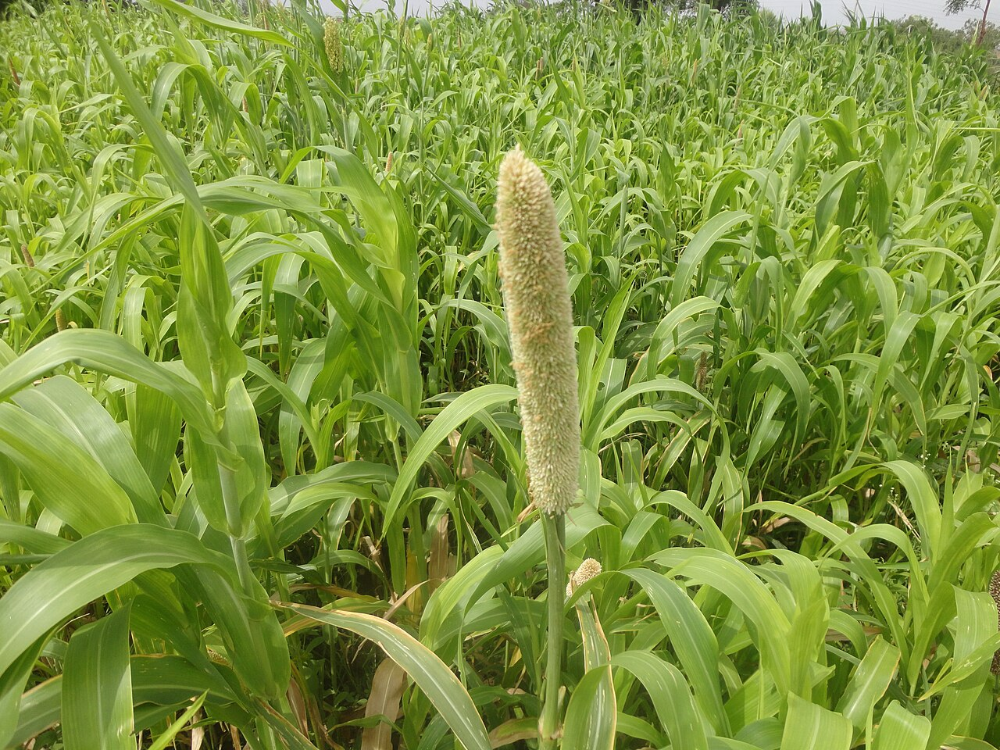

::: {.course-meta-block .quarto-title-meta}
:::: {.quarto-title-meta-heading}
Course dates
::::
:::: {.quarto-title-meta-contents}
 
::::
:::

As part of this 15-credit master's-level course at Campus Alnarp, SLUBI joined forces with colleagues from WIFORCE to deliver a bioinformatics module. The first part covered AI literacy, and the second introduced students to protein characterization using [Phytozome](https://phytozome-next.jgi.doe.gov/): gene reports, functional annotation, protein homologs, BlastP, distance trees, and domain annotation.

{.class width=70%}

*MGB CEE, [CC BY-SA 4.0](https://creativecommons.org/licenses/by-sa/4.0), via Wikimedia Commons*

