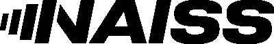

 

::: {.quarto-title-meta}
:::: {.quarto-title-meta-heading}
Date
::::
:::: {.quarto-title-meta-contents}
 
::::
:::

 
SLUBI will attend the [NAISS User Forum 2026](https://www.naiss.se/event/user-forum-2026/) to represent the bioinformatics users at SLU and make their needs heard.

The forum, organised by NAISS at the World Trade Center in Stockholm, brings together users and support staff from across the Swedish research computing community. 

Taking part gives us the chance to connect with other support groups, follow where national computing resources are heading, and carry the perspective of SLU's bioinformatics community into those discussions.

  

{.class width=40%}
