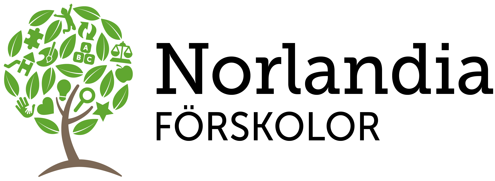

We had a wonderful day welcoming groups of preschoolers from [Norlandia förskolor](https://www.norlandia.se/forskolorna/) to the Veterinär- och husdjurscentrum (VHC) in Uppsala.

Together we explored animal skeletons and what they can reveal: how many legs an animal has, how big it is, and what it ate — all from the shape of its teeth and bones. The undisputed highlight was the lion skeleton.

This kind of "reading" is not so different from what bioinformaticians do — instead of bones, we read DNA sequences, but the questions are the same: how is this organism built, what does it eat, and how is it related to others?

 

{.class width=40%}

