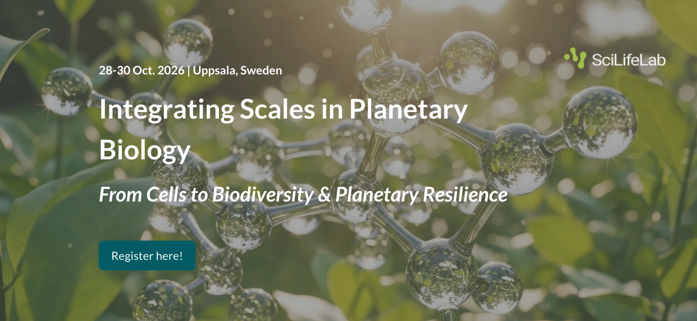

 

::: {.quarto-title-meta}
:::: {.quarto-title-meta-heading}
Dates
::::
:::: {.quarto-title-meta-contents}
 
::::
:::

 
SLUBI is happy to support **Integrating Scales in Planetary Biology 2026**, a conference led by SciLifeLab.

The conference explores how biological processes, from cells to ecosystems, shape the resilience of life on a changing planet. It is designed to build an international community across molecular biology, environmental science, and planetary health.

---

### Event details

**When:** 28-30 October 2026 
**Where:** Uppsala University Main Building, Biskopsgatan 3, Uppsala, Sweden

For the full programme and registration, see the [conference page](https://lyyti.events/p/Integrating_Scales_in_Planetary_Biology_5919#Programme).

  

[{.class width=90%}](https://lyyti.events/p/Integrating_Scales_in_Planetary_Biology_5919#Programme)
